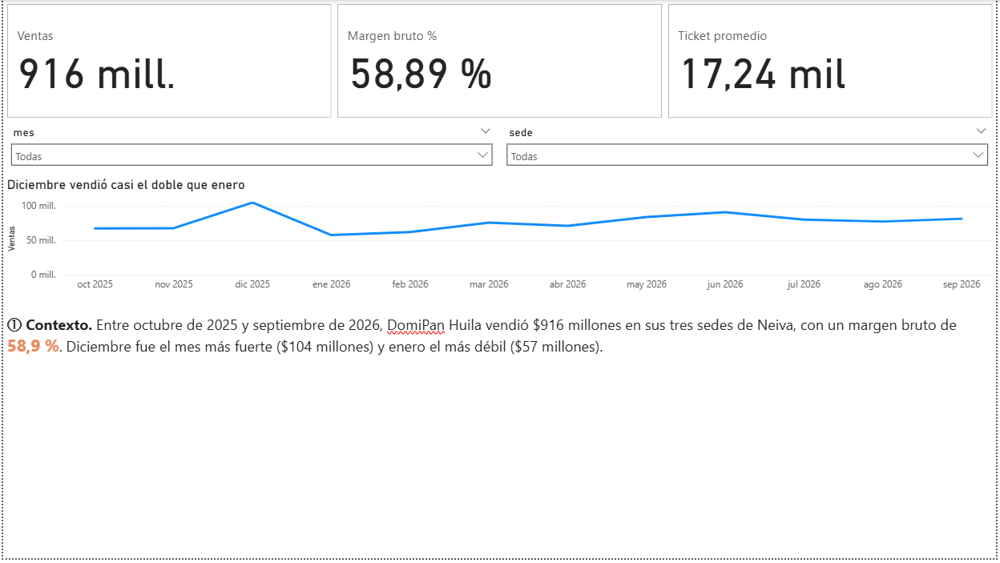
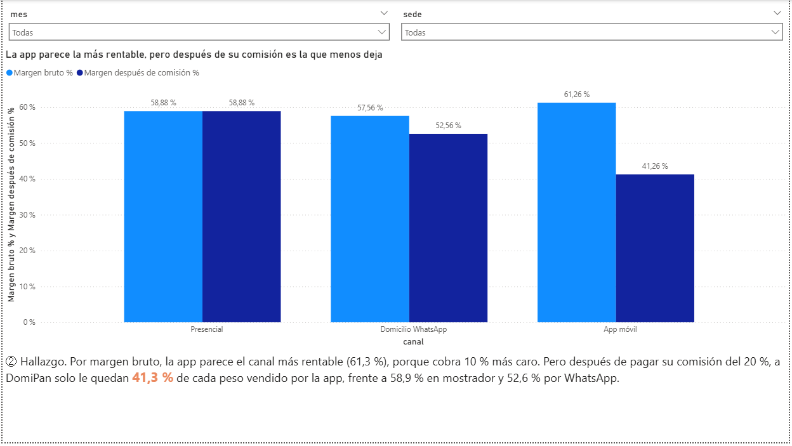
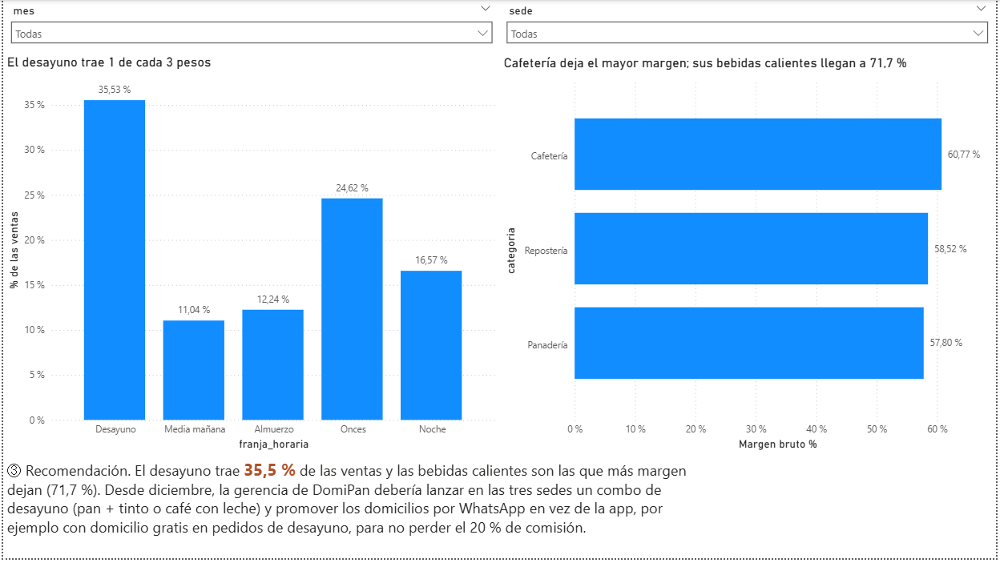
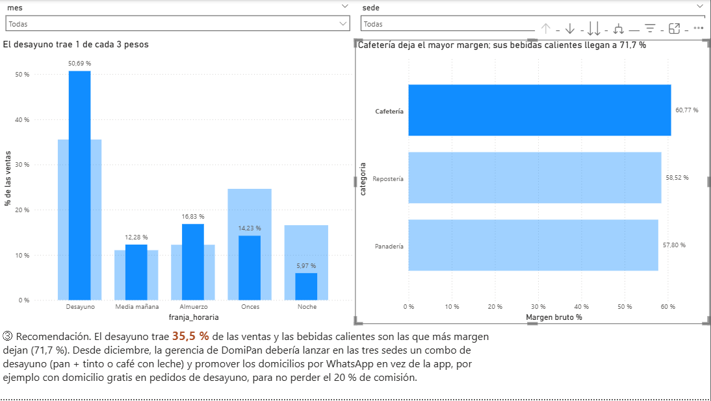
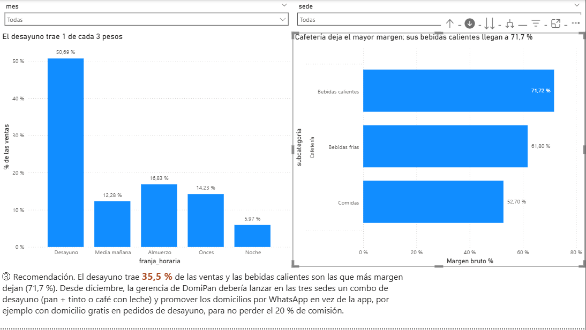

# Dashboard interactivo con narrativa · DomiPan Huila S.A.S.

**Actividad calificable · Corte 3 · Semana 14** · Electiva Inteligencia de Negocios 2026-B · Corhuila
**Estudiante:** Juan Manuel Rojas Mora

- **Archivo:** [`dashboard-domipan.pbix`](dashboard-domipan.pbix) (Power BI Desktop).
- **Datos:** datos sintéticos de DomiPan Huila S.A.S., una panadería ficticia con tres sedes en Neiva. Son los mismos del proyecto de aula (`15-week/proyecto-aula/`), pero este tablero es un archivo aparte, hecho para esta actividad.
- **Periodo:** 1 de octubre de 2025 al 30 de septiembre de 2026.

## Cómo está armado: tres páginas, tres momentos

| Página | Momento | Pregunta que responde | Visuales | Dato resaltado |
|---|---|---|---|---|
| 1 Contexto | Contexto | ¿Cuánto vende DomiPan y cómo se mueven las ventas en el año? | Tarjetas de KPI (ventas, margen bruto, ticket promedio) y gráfico de líneas de ventas por mes | **58,9 %** de margen bruto |
| 2 Hallazgo | Hallazgo | ¿Qué canal le deja más a DomiPan? | Columnas agrupadas: margen bruto y margen después de comisión, por canal | **41,3 %**: lo que le queda por la app |
| 3 Recomendación | Recomendación | ¿En qué franja y en qué productos concentrar el esfuerzo? | Columnas de % de ventas por franja horaria y barras de margen por categoría → subcategoría → producto | **35,5 %** de las ventas en el desayuno |

## Cumplimiento de la rúbrica

| Criterio | Cómo se cumple |
|---|---|
| **Gráficos correctos y buenas prácticas** | Cada gráfico se eligió según la pregunta: líneas para la tendencia por mes, columnas agrupadas para comparar dos márgenes por canal, columnas para las franjas en el orden del día y barras horizontales para las categorías (nombres largos). Todos los ejes de valores empiezan en **cero**. Hay **orden** con intención: canales por margen después de comisión, franjas de la mañana a la noche y categorías de mayor a menor margen. Hay **poca tinta**: tres tarjetas, sin leyendas ni adornos de más. Todos los títulos son **títulos-conclusión**, por ejemplo «Diciembre vendió casi el doble que enero». |
| **Interactividad** | Dos **segmentadores** (mes y sede), presentes en las tres páginas. Una **jerarquía con drill-down** categoría → subcategoría → producto en la página 3. El **filtrado cruzado está verificado**: al hacer clic en Cafetería, el gráfico de franjas muestra solo esa categoría (ver capturas). |
| **Narrativa y dato resaltado** | Un cuadro de texto por página (① Contexto, ② Hallazgo, ③ Recomendación), cada uno con su dato resaltado en naranja: 58,9 %, 41,3 % y 35,5 %. |
| **Dashboard & insight (EN)** | Sección en inglés al final de este README. |

## Modelo y medidas DAX

**Modelo estrella:** `Fact_Ventas` (una fila por producto dentro de un pedido) relacionada de varios a uno con `Dim_Producto`, `Dim_Cliente`, `Dim_Sede`, `Dim_Canal` y `Dim_Calendario`. `Dim_Calendario` se creó con DAX y está marcada como tabla de fechas; la fecha y hora automáticas están desactivadas.

```
Ventas = SUMX ( Fact_Ventas, Fact_Ventas[cantidad] * Fact_Ventas[precio_unitario] )
Costo de ventas = SUMX ( Fact_Ventas, Fact_Ventas[cantidad] * Fact_Ventas[costo_unitario] )
Margen bruto % = DIVIDE ( [Ventas] - [Costo de ventas], [Ventas] )
Pedidos = DISTINCTCOUNT ( Fact_Ventas[id_pedido] )
Ticket promedio = DIVIDE ( [Ventas], [Pedidos] )
Comisión = SUMX ( Fact_Ventas, Fact_Ventas[cantidad] * Fact_Ventas[precio_unitario] * RELATED ( Dim_Canal[comision_pct] ) )
Margen después de comisión % = DIVIDE ( [Ventas] - [Costo de ventas] - [Comisión], [Ventas] )
% de las ventas = DIVIDE ( [Ventas], CALCULATE ( [Ventas], ALLSELECTED ( Fact_Ventas[franja_horaria], Fact_Ventas[orden_franja] ) ) )
```

Las cifras del tablero coinciden con las de control calculadas fuera de Power BI: ventas $915.980.100, margen bruto 58,89 % y ticket promedio $17.239.

## Capturas

**Página 1 · Contexto**



**Página 2 · Hallazgo**



**Página 3 · Recomendación**



**Filtrado cruzado:** al seleccionar la barra Cafetería, el gráfico de franjas resalta solo esa categoría; el 50,7 % de lo que vende Cafetería ocurre en el desayuno.



**Drill-down:** al bajar desde Cafetería, aparecen sus subcategorías; las bebidas calientes dejan 71,7 % de margen.



## Dashboard & insight

This Power BI dashboard analyzes twelve months of sales (October 2025 to September 2026) for DomiPan Huila S.A.S., a fictional bakery with three stores in Neiva, Colombia. It tells a three-page story (context, finding and recommendation), and every page can be filtered by month and by store with two slicers. The context page shows total sales of COP 916 million with a gross margin of 58.9%, and its line chart reveals that December sold almost twice as much as January. The key insight is on the second page: the mobile app looks like the most profitable channel by gross margin (61.3%), but after paying its 20% commission DomiPan keeps only 41.3% of every peso sold through the app, compared with 58.9% in the stores and 52.6% through WhatsApp. The third page shows that breakfast brings in 35.5% of sales and, with a drill-down from category to product, that hot drinks have the highest margin (71.7%). The recommendation is that, starting in December, management launch a breakfast combo (bread plus coffee) in all three stores and move delivery customers from the app to WhatsApp, for example with free delivery on breakfast orders, to stop losing the app commission.
