# ETL en Power Query · DomiPan Huila S.A.S.

**Fase 1 · Datos y ETL.** Herramienta: Power Query en Power BI Desktop (archivo [`DomiPan.pbix`](DomiPan.pbix)).
Configuración regional del archivo: **Español (Colombia)**, para que Power BI lea las fechas como día/mes/año y el punto como separador de miles.

## 1. Fuentes conectadas (Extraer)

| Consulta en Power BI | Archivo de origen | Cómo se conectó |
|---|---|---|
| Fact_Ventas | `ventas_domipan.csv` | Texto/CSV, codificación UTF-8, delimitador coma, **sin detección automática de tipos** |
| Dim_Producto, Dim_Cliente, Dim_Sede, Dim_Canal y Festivos | `maestros_domipan.xlsx` | Libro de Excel, una consulta por hoja |

Las consultas se escribieron en el *Editor avanzado* de Power Query (lenguaje M), con un comentario por paso que explica qué hace; ese comentario aparece como descripción del paso (ícono ⓘ en *Pasos aplicados*). Los nombres de los pasos se citan entre comillas en este documento.

Se desactivó la detección automática de tipos porque Power BI adivina el tipo mirando solo las primeras filas. Con datos sucios adivina mal o esconde el problema; así se ve el dato crudo y el tipo de cada columna se decide a propósito.

Datos crudos: las filas de la app (canal CAN03) traen la fecha como `01/10/2025` y el precio como `$1.300`, mientras las demás traen `2025-10-01` y `1300`.

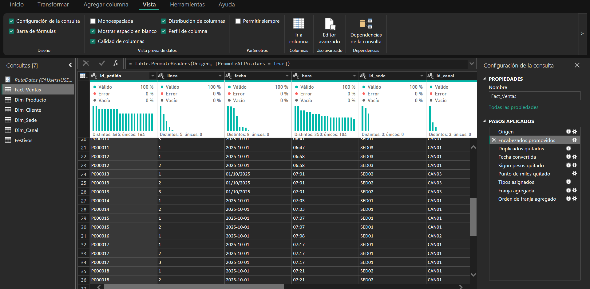

## 2. Problemas de calidad corregidos (Transformar)

### Problema 1 · Pedidos duplicados

Al sincronizar, algunos pedidos de domicilio quedaron registrados dos veces.

**Paso aplicado:** «Duplicados quitados», que quita las filas idénticas en todas las columnas (equivale a *Quitar duplicados* con todas las columnas seleccionadas).
**Motivo:** una fila solo es duplicada si es idéntica en todas sus columnas. Si se quitaran duplicados mirando solo `id_pedido`, se borrarían los demás productos de pedidos legítimos.

| | Antes | Después |
|---|---|---|
| Filas | 114.764 | 114.144 |

Se eliminaron 620 filas repetidas, de 222 pedidos.

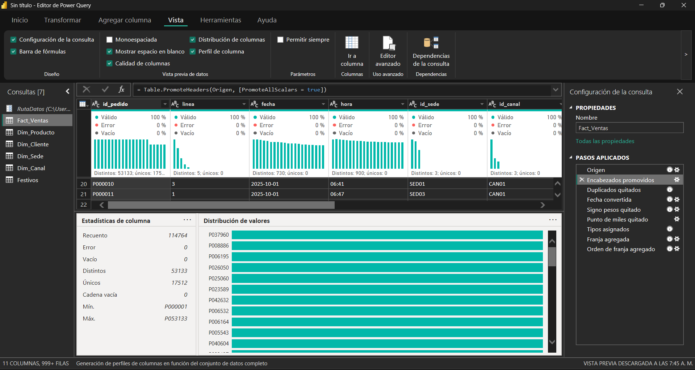
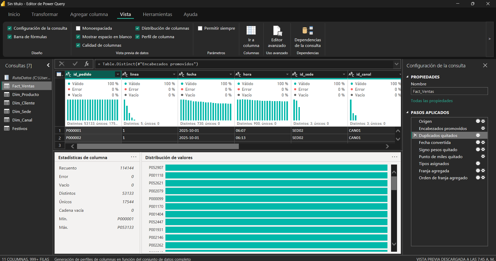

### Problema 2 · Fechas en dos formatos

La caja guarda la fecha como `aaaa-mm-dd` y la app como `dd/mm/aaaa`.

**Paso aplicado:** «Fecha convertida», que cambia el tipo de `fecha` a *Fecha* **usando la configuración regional Español (Colombia)**.
**Motivo:** con configuración en inglés, `01/10/2025` se leería como 10 de enero (un error silencioso) y `13/10/2025` daría error. Con Español (Colombia) los dos formatos se convierten bien.

| | Antes | Después |
|---|---|---|
| Tipo | Texto | Fecha |
| Valores distintos | 730 (cada día escrito de dos formas) | 365 |
| Errores | — | 0 % |
| Rango | — | 01/10/2025 a 30/09/2026 |

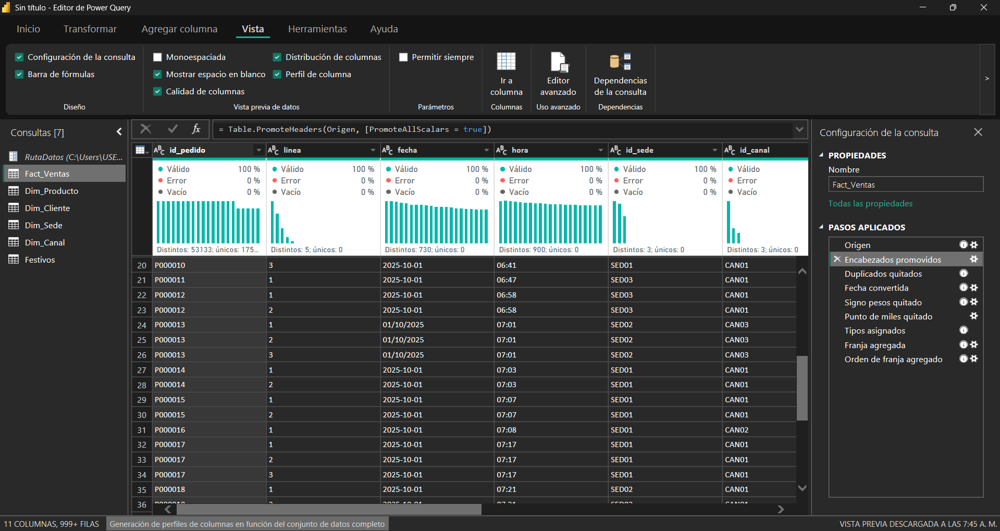
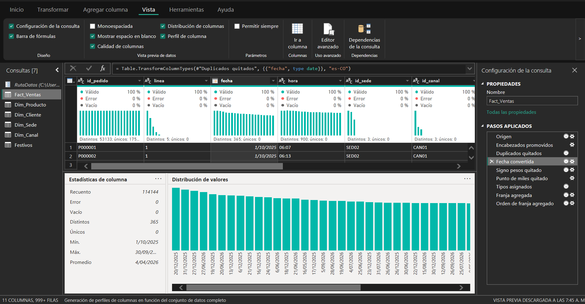

### Problema 3 · Precio guardado como texto

La app exporta el precio con signo y punto de miles (`$2.200`).

**Pasos aplicados:** «Signo pesos quitado» (reemplaza `$` por nada), «Punto de miles quitado» (reemplaza `.` por nada) y «Tipos asignados» (cambia el tipo a *Número entero*).
**Motivo:** el signo y el punto son formato para leer, no parte del número. Todos los precios son pesos enteros, así que el punto solo separa miles y quitarlo no cambia el valor (`$2.200` → `2200`).

| | Antes | Después |
|---|---|---|
| Tipo | Texto | Número entero |
| Filas con `$` | 16.657 | 0 |
| Errores | — | 0 % |

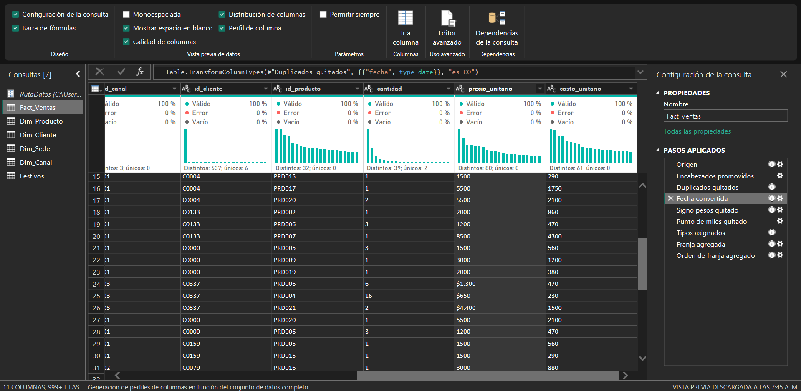
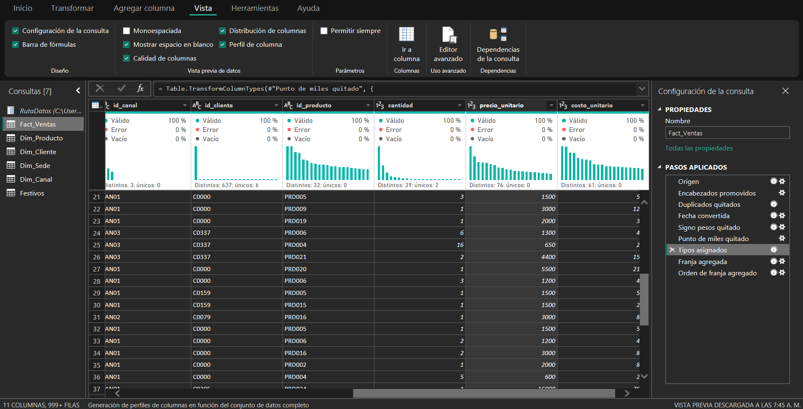

### Problema 4 · Nombres y categorías escritos distinto (hoja Productos)

El catálogo lo digitaron varias personas: hay espacios de más, mayúsculas mezcladas y tildes faltantes.

**Pasos aplicados:**
1. *Recortar* en `producto` y `categoria`, para quitar los espacios del principio y del final.
2. *Poner En Mayúscula Cada Palabra* solo en `categoria` (`PANADERÍA` → `Panadería`).
3. *Reemplazar los valores*, con coincidencia de toda la celda: `Panaderia` → `Panadería`, `Cafeteria` → `Cafetería`, `Reposteria` → `Repostería`.
4. *Reemplazar los valores* en `producto`: `almojabana` → `Almojábana`, `PAN DE QUESO` → `Pan de queso`, `croissant de mantequilla` → `Croissant de mantequilla`, `Cafe Con Leche` → `Café con leche`, `porcion tres leches` → `Porción tres leches`.

**Motivo:** sin esta corrección el tablero mostraría «Panaderia» y «Panadería» como dos categorías distintas, y el margen por categoría saldría partido. En los productos no se usó *Mayúscula cada palabra* porque cambiaría los nombres que ya estaban bien («Pan de queso» → «Pan De Queso»).

| | Antes | Después |
|---|---|---|
| Valores distintos en `categoria` | 10 | 3 |
| Nombres de producto mal escritos | 5 | 0 |

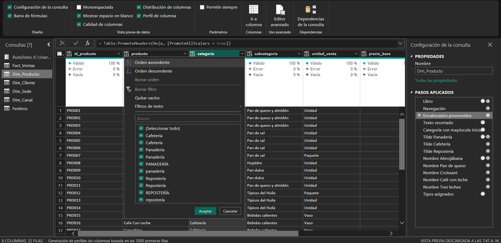
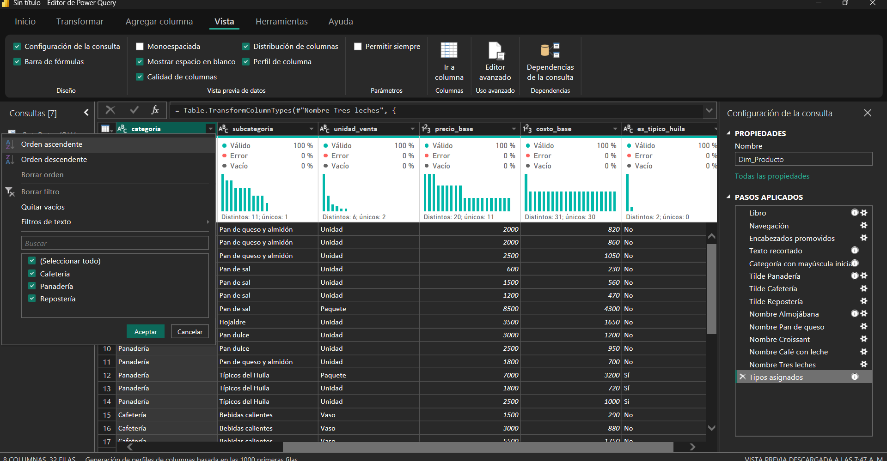

## 3. Otros pasos en Fact_Ventas

| Paso | Motivo |
|---|---|
| Tipos: códigos (`id_pedido`, `id_sede`, `id_canal`, `id_cliente`, `id_producto`) como Texto; `linea`, `cantidad` y `costo_unitario` como Número entero; `hora` como Hora | Cada columna con el tipo que corresponde a su contenido, para poder sumar, contar y relacionar |
| Columna nueva `franja_horaria`, con una condición sobre la hora (si es menor que 10, Desayuno; si es menor que 12, Media mañana; y así sucesivamente) | La pregunta de negocio habla de franjas, pero el dato solo trae la hora |
| Columna nueva `orden_franja` (1 a 5) | Para que los gráficos muestren las franjas en orden del día y no en orden alfabético |

| Franja | Horas | orden_franja |
|---|---|---|
| Desayuno | 6:00 a 9:59 | 1 |
| Media mañana | 10:00 a 11:59 | 2 |
| Almuerzo | 12:00 a 14:59 | 3 |
| Onces | 15:00 a 17:59 | 4 |
| Noche | 18:00 a 21:00 | 5 |

Pasos aplicados en Fact_Ventas:

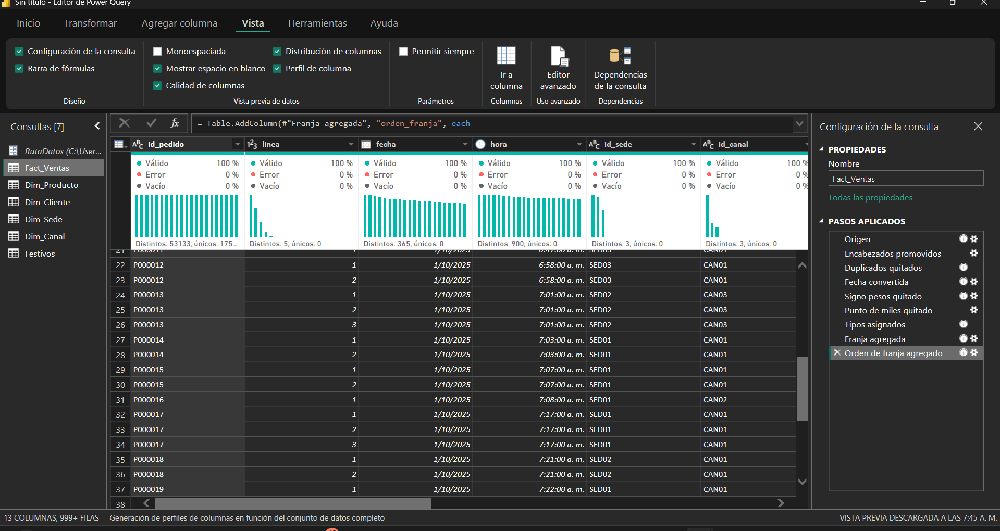

Pasos aplicados en Dim_Producto:

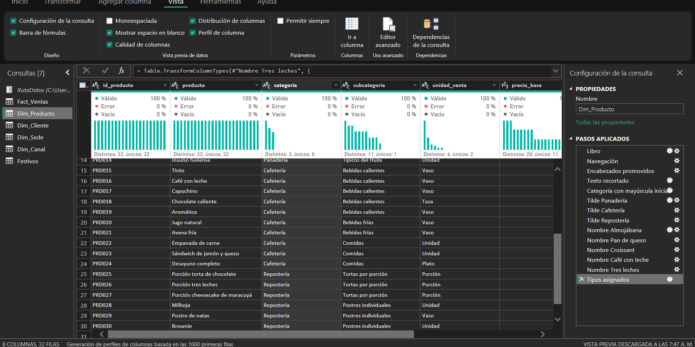

## 4. Carga y comprobación con las cifras de control (Cargar)

Las consultas se cargaron con *Cerrar y aplicar*. El resultado se comparó con las cifras de control calculadas en Python sin usar Power BI ([`generacion-datos.md`](generacion-datos.md), sección 5):

| Cifra | Cifra de control (Python) | Resultado en Power BI |
|---|---|---|
| Filas de Fact_Ventas | 114.144 | 114.144 |
| Pedidos distintos | 53.133 | 53.133 |

Las dos cifras coinciden, así que el ETL no perdió ni duplicó información.

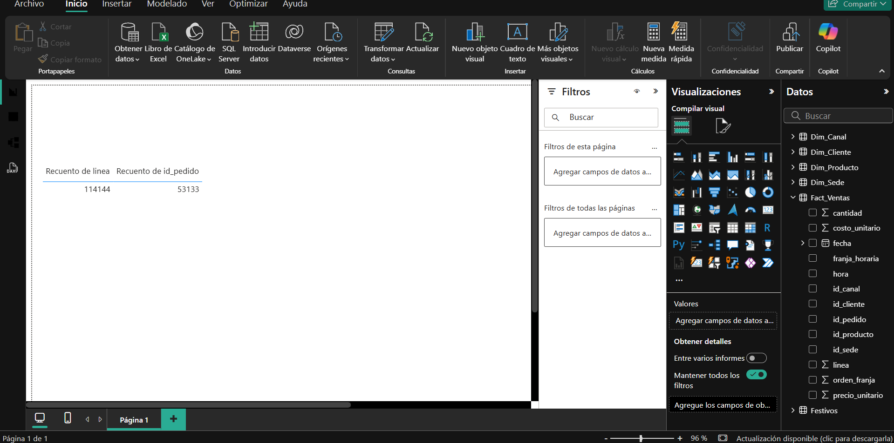
