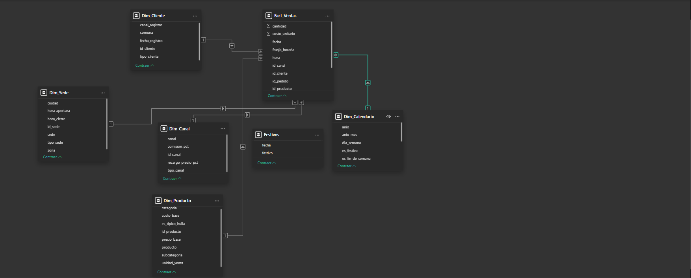
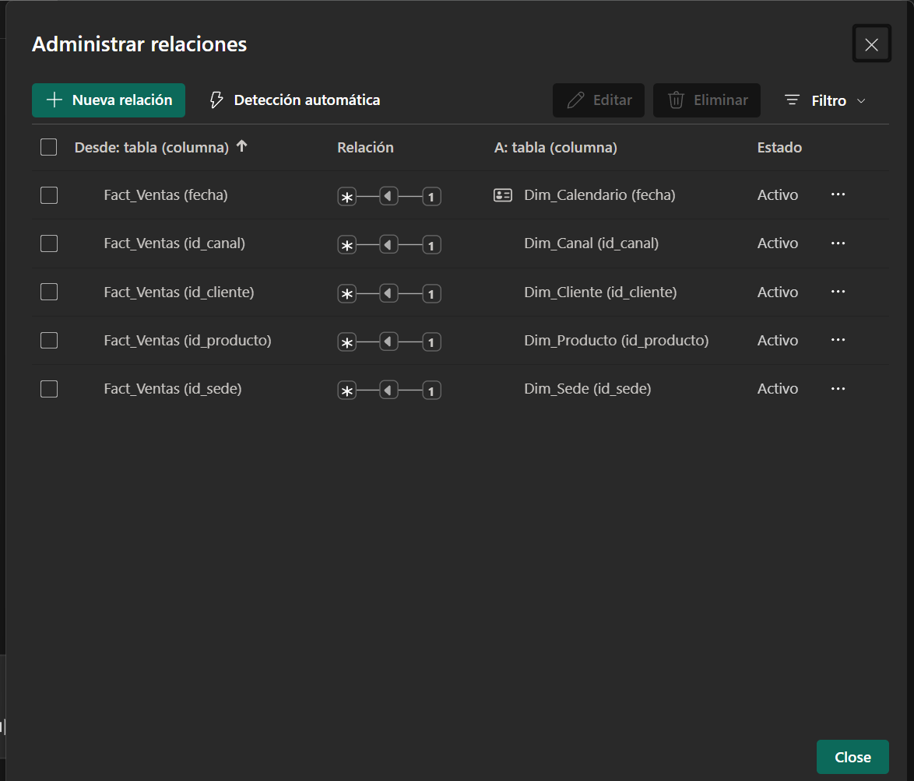
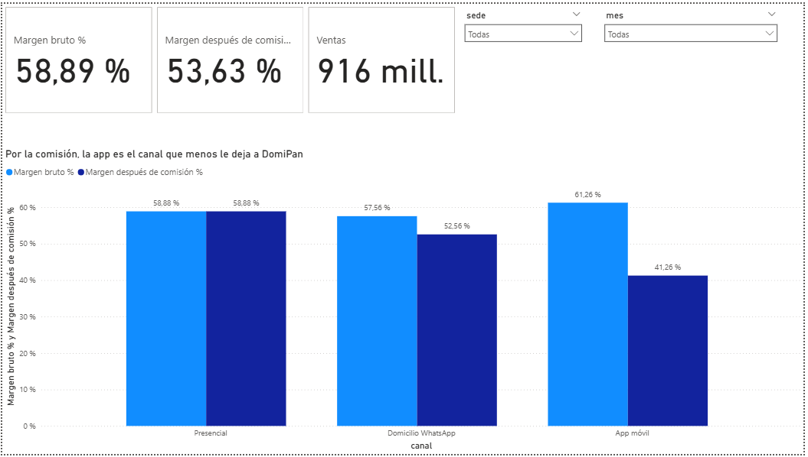
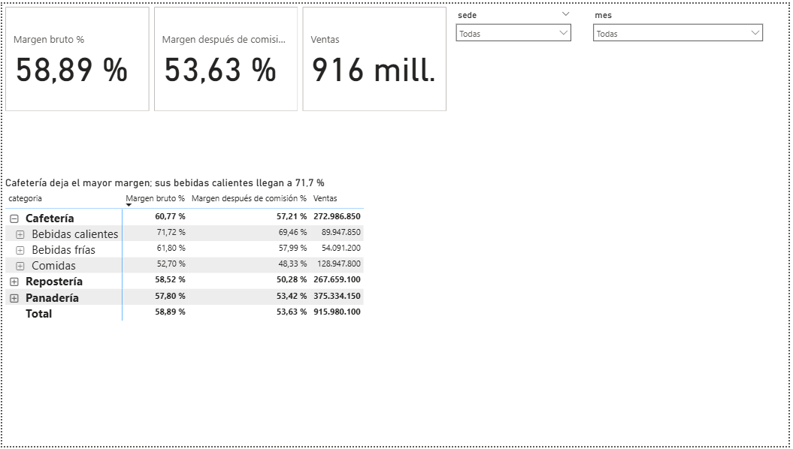
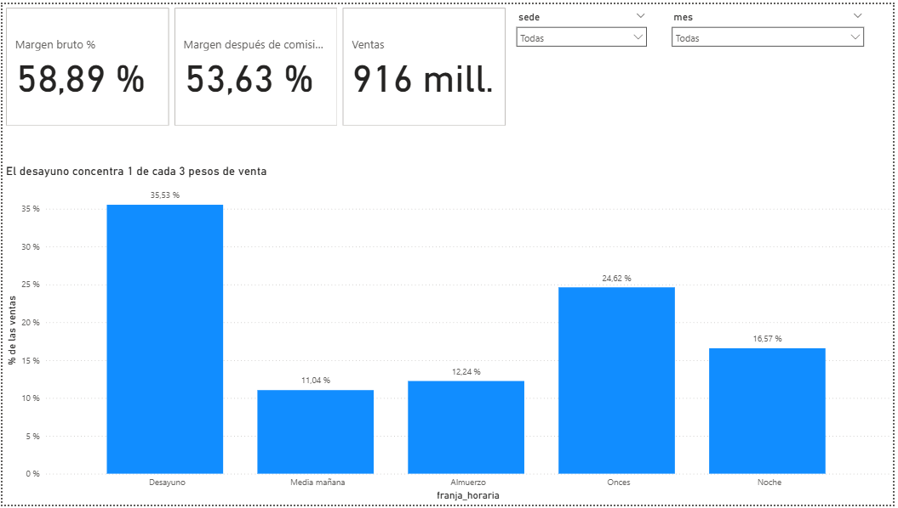
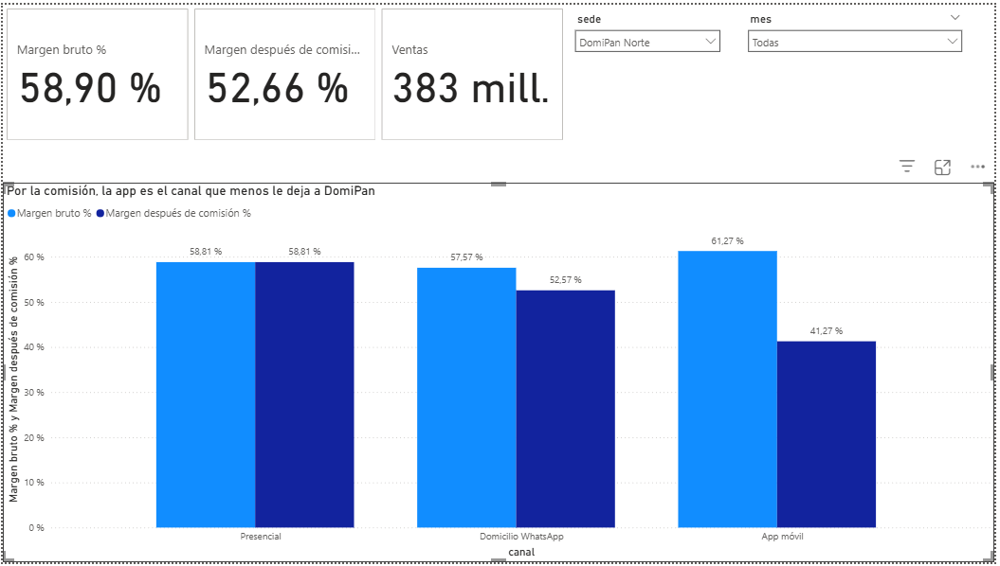
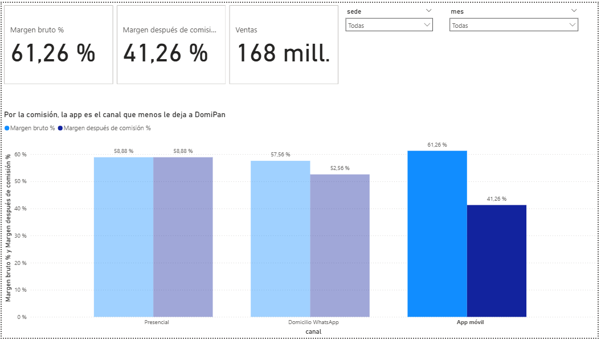
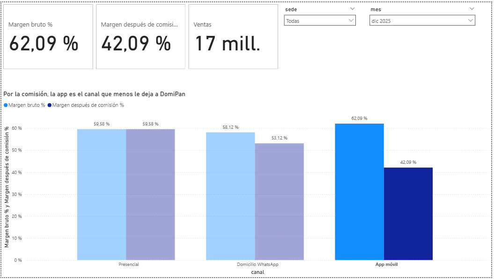

# Fase 2 · Modelo, medidas DAX y tablero · DomiPan Huila S.A.S.

Archivo: [`DomiPan.pbix`](DomiPan.pbix) (Power BI Desktop). Las cifras de control se calcularon con Python sobre los datos limpios, sin usar Power BI, y se compararon con lo que muestra el tablero.

## 1. Modelo estrella

`Fact_Ventas` (una fila = un producto dentro de un pedido) está en el centro, relacionada de **varios a uno**, con filtro en una sola dirección, con cuatro dimensiones y el calendario:

| Desde (varios) | Hacia (uno) | Columna |
|---|---|---|
| Fact_Ventas | Dim_Calendario | fecha |
| Fact_Ventas | Dim_Canal | id_canal |
| Fact_Ventas | Dim_Cliente | id_cliente |
| Fact_Ventas | Dim_Producto | id_producto |
| Fact_Ventas | Dim_Sede | id_sede |

- `Dim_Calendario` se creó con DAX (un día por fila, del 01/10/2025 al 30/09/2026) y está **marcada como tabla de fechas**. La columna `mes` se ordena por `anio_mes`.
- Se desactivó «Fecha y hora automáticas», para no crear tablas de fechas ocultas.
- `franja_horaria` se ordena por `orden_franja`, para que las franjas salgan en el orden del día.

```
Dim_Calendario =
VAR Base = CALENDAR ( DATE ( 2025, 10, 1 ), DATE ( 2026, 9, 30 ) )
RETURN
    ADDCOLUMNS (
        SELECTCOLUMNS ( Base, "fecha", [Date] ),
        "anio", YEAR ( [fecha] ),
        "mes_num", MONTH ( [fecha] ),
        "mes", FORMAT ( [fecha], "mmm yyyy" ),
        "anio_mes", YEAR ( [fecha] ) * 100 + MONTH ( [fecha] ),
        "trimestre", "T" & QUARTER ( [fecha] ),
        "dia_semana", FORMAT ( [fecha], "dddd" ),
        "num_dia_semana", WEEKDAY ( [fecha], 2 ),
        "es_fin_de_semana", IF ( WEEKDAY ( [fecha], 2 ) >= 6, "Sí", "No" ),
        "es_festivo", VAR f = [fecha] RETURN IF ( f IN VALUES ( Festivos[fecha] ), "Sí", "No" )
    )
```




## 2. Medidas DAX y cifras de control

| Medida | Fórmula | Qué calcula | Cifra de control (todo el periodo) | Resultado en Power BI |
|---|---|---|---|---|
| Ventas | `SUMX ( Fact_Ventas, Fact_Ventas[cantidad] * Fact_Ventas[precio_unitario] )` | Ventas en pesos | $915.980.100 | $915.980.100 (total de la matriz) ✅ |
| Costo de ventas | `SUMX ( Fact_Ventas, Fact_Ventas[cantidad] * Fact_Ventas[costo_unitario] )` | Lo que costó producir lo vendido | $376.515.020 | Se comprueba con el margen bruto ✅ |
| **Margen bruto %** (KPI principal) | `DIVIDE ( [Ventas] - [Costo de ventas], [Ventas] )` | Parte de cada peso vendido que queda después del costo | 58,89 % | 58,89 % ✅ |
| Pedidos | `DISTINCTCOUNT ( Fact_Ventas[id_pedido] )` | Pedidos distintos | 53.133 | 53.133 (comprobado en la Fase 1) ✅ |
| Ticket promedio | `DIVIDE ( [Ventas], [Pedidos] )` | Venta promedio por pedido | $17.239 | Se deriva de Ventas y Pedidos ✅ |
| Comisión | `SUMX ( Fact_Ventas, Fact_Ventas[cantidad] * Fact_Ventas[precio_unitario] * RELATED ( Dim_Canal[comision_pct] ) )` | Lo que se queda el canal (5 % WhatsApp, 20 % app) | $48.230.710 | Se comprueba con el margen después de comisión ✅ |
| Margen después de comisión % | `DIVIDE ( [Ventas] - [Costo de ventas] - [Comisión], [Ventas] )` | Lo que realmente le queda a DomiPan | 53,63 % | 53,63 % ✅ |
| % de las ventas | `DIVIDE ( [Ventas], CALCULATE ( [Ventas], ALLSELECTED ( Fact_Ventas[franja_horaria], Fact_Ventas[orden_franja] ) ) )` | Participación de cada franja en las ventas | Desayuno 35,53 % | 35,53 % ✅ |

En `% de las ventas` van **las dos** columnas dentro de `ALLSELECTED`, porque `franja_horaria` se ordena por `orden_franja`. Con una sola, todas las franjas daban 100 %.

## 3. Tablero: una pregunta por página

En las tres páginas, la tarjeta del KPI (margen bruto, margen después de comisión y ventas) está **arriba a la izquierda**, y los segmentadores **sede** y **mes** están arriba a la derecha, **sincronizados** entre páginas.

| Página | Pregunta | Visual | Título-conclusión |
|---|---|---|---|
| 1 Canales | ¿Qué canal le deja más a DomiPan? | Columnas agrupadas: margen bruto y margen después de comisión por canal | Por la comisión, la app es el canal que menos le deja a DomiPan |
| 2 Productos | ¿Qué productos dejan más margen? | Matriz con **jerarquía categoría → subcategoría → producto** (drill-down con ⊞) | Cafetería deja el mayor margen; sus bebidas calientes llegan a 71,7 % |
| 3 Franjas | ¿En qué franja se concentra la venta? | Columnas: % de las ventas por franja horaria | El desayuno concentra 1 de cada 3 pesos de venta |







**Interacciones revisadas:** los segmentadores filtran todos los visuales de la página. Al hacer clic en una columna del gráfico de canales, las tarjetas se filtran y los demás canales se ven en color pálido (filtrado cruzado; ver la prueba 2).

## 4. Prueba del clic

Tres selecciones en la página 1 Canales, comparadas con las cifras de control calculadas en Python:

| # | Selección | Tablero (margen bruto · margen después de comisión · ventas) | Cifra de control | ¿Coincide? |
|---|---|---|---|---|
| 1 | Segmentador sede = DomiPan Norte | 58,90 % · 52,66 % · 383 mill. | 58,90 % · 52,66 % · $383.354.550 | ✅ |
| 2 | Clic en la columna App móvil (filtrado cruzado) | 61,26 % · 41,26 % · 168 mill. | 61,26 % · 41,26 % · $167.884.900 | ✅ |
| 3 | App móvil + segmentador mes = dic 2025 | 62,09 % · 42,09 % · 17 mill. | 62,09 % · 42,09 % · $17.330.300 | ✅ |

Las tres selecciones coinciden con las cifras de control, así que las medidas y las relaciones filtran bien.






